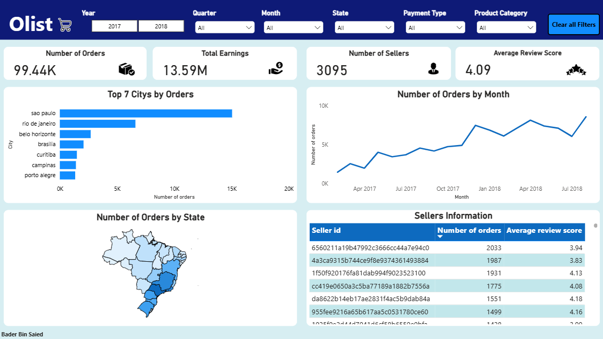
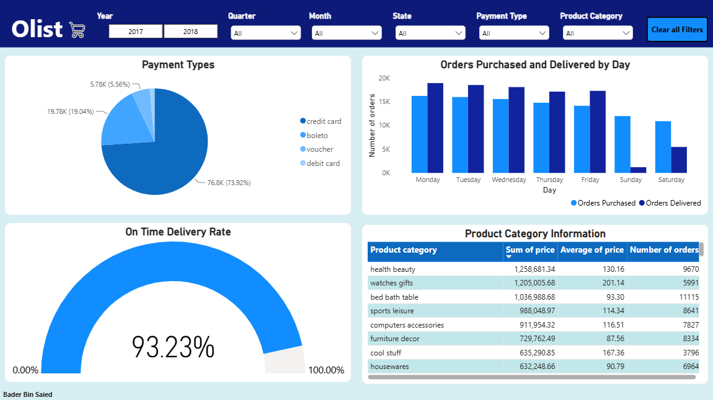
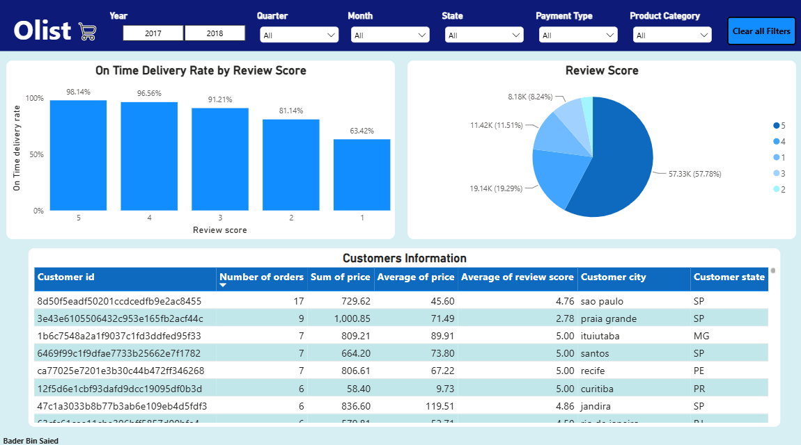

# Brazilian E-Commerce Data Analysis | Power BI

## Project Overview
This project analyzes Brazilian e-commerce data using Power BI to explore order performance, delivery efficiency, customer satisfaction, and sales trends.

## Dashboard Preview

### 1. Page 1

### 2. Page 2

### 3. Page 3

## Key Analysis Areas
- **Order Performance:** Analysis of order statuses and order volume.
- **Delivery Performance:** Evaluation of delivery delays and on-time deliveries.
- **Customer Satisfaction:** Exploring the relationship between delivery performance and customer review scores.
- **Geographic Analysis:** Exploring order distribution across Brazilian states.

## Tools Used
- Power BI
- Power Query
- DAX

## Project File
Download the Power BI report (`.pbix`) from the files listed in this repository and open it using Power BI Desktop.

## Data Source
https://www.kaggle.com/datasets/olistbr/brazilian-ecommerce
